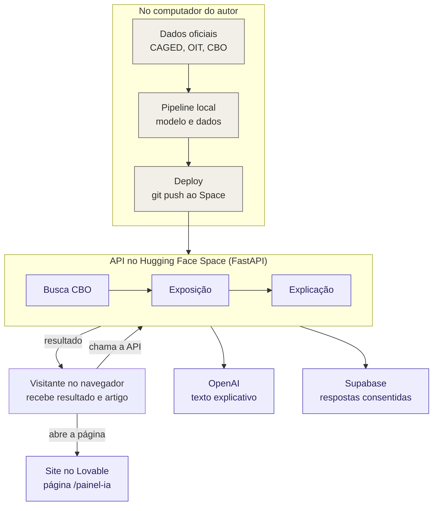

# IA generativa e a entrada de jovens no mercado de trabalho brasileiro

Pesquisa, dados e um painel interativo sobre o que a inteligência artificial generativa está fazendo com o emprego no Brasil, 2020–2026.

- **Painel interativo:** [horizontedigital.org/painel-ia](https://horizontedigital.org/painel-ia). A pessoa descreve o cargo e vê o quanto a ocupação está exposta à IA e o que os dados oficiais de contratação mostram para o seu perfil.
- **Artigo (português e inglês):** pasta [`artigo/`](artigo/), *Ponte estreita: o impacto da inteligência artificial no mercado de trabalho e na entrada de jovens na carreira no Brasil, 2020–2026*.
- **Fontes e licenças dos dados:** [`data/ref/FONTES.md`](data/ref/FONTES.md) e [`painel_ia/dados/FONTES.md`](painel_ia/dados/FONTES.md).

> No Brasil, a IA generativa não está fechando a porta de entrada do mercado de trabalho, mas a ponte para a carreira ficou mais estreita. As ocupações mais expostas mantêm seus empregos, trocam menos de pessoal e contratam menos diplomados. Quem sente é o jovem de 25 a 29 anos, cuja contratação cai de forma lenta e contínua desde 2023, sem migração para a informalidade.

---

## A história do projeto

### A pergunta

Duas frases dominam o debate público sobre IA e trabalho: "a IA vai destruir empregos" e "os jovens não conseguem mais o primeiro emprego por causa da IA". Quase tudo o que se sabe sobre isso vem dos Estados Unidos e da Europa. Faltava saber o que os dados brasileiros dizem. O projeto nasceu para responder duas perguntas:

1. **Qual o impacto geral da IA no emprego?** O emprego nas ocupações mais expostas cai?
2. **A IA está tirando dos mais jovens a primeira entrada na carreira?**

### O desenho da pesquisa

A investigação usa três bases oficiais:

- **Novo CAGED** (MTE), de janeiro de 2020 a setembro de 2026: mais de 300 milhões de movimentações de emprego formal, com os totais validados contra as tabelas do próprio MTE.
- **PNAD Contínua** (IBGE), 27 trimestres de 2020T1 a 2026T3, que cobre também o trabalho informal e serve de confirmação independente do registro administrativo.
- **Índice de exposição à IA generativa da OIT** (Gmyrek et al., 2025), traduzido para a CBO brasileira por uma "ponte" de três passos (CBO 2002, ISCO-88, ISCO-08).

O método central é uma **diferença tripla em *event study***: compara jovens e adultos, em ocupações mais e menos expostas, trimestre a trimestre. Como a comparação é feita dentro da mesma ocupação, ela neutraliza choques que atingem todas as idades. A **pandemia** recebe tratamento próprio, porque atingiu de forma desigual justamente as ocupações de escritório e comércio. Ela é isolada com controles medidos no próprio CAGED, fases separadas e uma versão da análise que descarta 2020–2021.

### O que os dados mostraram

A hipótese de partida, inspirada na literatura americana, era que o golpe cairia sobre quem tenta o primeiro emprego (18 a 24 anos). **Não caiu.** O efeito aparece no degrau seguinte, entre 25 e 29 anos, e é pequeno, gradual e consistente em dezenas de variantes de robustez. Daí o nome do artigo: a ponte que leva à carreira ficou mais estreita, não foi derrubada.

O título tem também uma origem pessoal. A Ponte Estreita ficava na Rua Joaquim Gonçalves Dutra, em Manhuaçu (MG), cidade natal do autor. A ponte antiga foi derrubada e reconstruída mais larga, para acompanhar o crescimento da rua. A rua, nesta metáfora, é a economia que adota IA, e a ponte precisa crescer junto.

### Do artigo ao painel

Um artigo acadêmico responde às perguntas da pesquisa, mas não responde à pergunta de quem o lê: *e a minha profissão?* O painel interativo foi construído para isso. Ele traduz as medidas do estudo para uma pessoa só: digita o cargo, confirma a ocupação da CBO e vê a exposição, o tipo de transformação esperada, as tarefas mais e menos expostas e o que aconteceu com as contratações do seu perfil desde 2022.

Três decisões moldaram o painel:

- **Honestidade sobre o que os dados dizem.** O texto sempre deixa claro que exposição não é perda de emprego e que a evidência de contratações é um retrato do que aconteceu, não prova de que a causa seja a IA.
- **Texto curto e preso aos dados.** A explicação é escrita por um modelo de linguagem que só recebe os números e as tarefas da ocupação, com limite de tamanho, linguagem simples e proibição de inventar. Se a OpenAI falhar, um texto de reserva determinístico assume, e o painel nunca mostra texto pela metade.
- **Privacidade por desenho.** Nada é gravado sem consentimento, e só se gravam campos categóricos, nunca texto livre.

### Estado atual

O pipeline e as análises estão concluídos, o artigo está em fase final de redação e o painel está no ar. A agenda futura inclui o teste direto dos empregos de escritório contra as demais ocupações e as trajetórias na RAIS.

---

## Principais resultados

Todos os efeitos em "%" são 100 × coeficiente PPML, interpretados como variação aproximada **por desvio-padrão de exposição** (a exposição média ponderada pelas admissões é 0,29, com desvio-padrão de 0,17). Os resultados descrevem associações e padrões, e o texto do artigo discute com cuidado o que se pode ou não afirmar sobre causa.

| Achado | Resultado |
|---|---|
| **18–24 anos: primeira entrada** | Sem efeito médio (0,0%, IC ±3%). Nulo também na PNAD. |
| **25–29 anos: o degrau seguinte** | Queda de −2,4% (p = 0,009) no CAGED. Negativa nas 12 variantes de robustez em que pode ser estimada e significativa em 11. |
| **Confirmação na PNAD** | A entrada de recém-chegados de 25–29 cai −2,9% (p = 0,03), concentrada na entrada formal (−4,2%). |
| **Vagas não abertas (25–29)** | Cerca de 148 mil de 2023T1 a 2026T3 (IC 95%: 25 mil a 273 mil), ou 1,9% das admissões desse grupo nas ocupações mais expostas. São vagas que faltaram em relação aos adultos, não postos destruídos. |
| **Mercado como um todo** | O estoque de ocupados nas ocupações expostas não cai (+2,1% na PNAD). Admissões e desligamentos caem juntos, o que indica menos rotatividade. |
| **Diplomados** | As admissões com ensino superior caem −5,6% (p < 0,001), mesmo com controle do ciclo setorial, e a queda se aprofunda até 2026. |
| **Informalidade** | Não há migração para a informalidade: a entrada informal não aumenta. |
| **Quem sente mais (25–29)** | Nas admissões com ensino superior, a queda se concentra nas mulheres (−3,4% contra 0,0% dos homens). Nas admissões totais, pessoas negras (−3,0% contra −1,9% de brancas) e, por região, Sudeste e Centro-Oeste (−2,9%) mais que o Norte (−1,6%). Diferenças significativas após correção de Holm. |

O artigo traz as tabelas completas, a pré-tendência, a aceleração depois de 2023 e as 15 variantes de robustez.

---

## O painel interativo

### O que a pessoa vê

1. Digita o cargo com as próprias palavras.
2. Confirma a ocupação da CBO entre as sugestões (a busca usa um modelo de embeddings ajustado para a CBO, com TF-IDF como apoio).
3. Informa o perfil: faixa etária, escolaridade, UF, tempo na função e uso de IA no trabalho.
4. Recebe o resultado em três camadas: a **exposição** (índice da OIT), a **natureza** do efeito (substituição, transformação, complementaridade ou pouco afetada) e as **contratações no CAGED** para o seu perfil, com nível de confiança.
5. Lê uma explicação curta e baixa os artigos em português e inglês.

### Arquitetura



- **Roxo:** roda online. **Cinza:** roda no computador do autor.
- O Lovable só entrega a página e os PDFs. É o **navegador** da pessoa que chama a API, por isso a API libera, via `ORIGENS_PERMITIDAS`, apenas o domínio do site.
- A API combina três módulos: a busca encontra a CBO a partir do texto, a exposição junta a classificação da OIT e as evidências do CAGED, e a explicação monta o texto.
- Os dados oficiais passam pelo pipeline do estudo, que gera o modelo de busca e as evidências. O `montar_space.py` empacota tudo e o `git push` publica no Space.

### Privacidade (LGPD)

- Nenhum analytics, pixel ou cookie de rastreamento nas páginas do painel.
- Nada é gravado sem consentimento. Há duas caixas, desmarcadas por padrão, e a segunda (raça/cor) é separada da primeira.
- Só se gravam campos categóricos (mês, CBO, família, exposição, faixa etária, escolaridade, UF, tempo na função). Nunca texto livre ou dado pessoal, e a raça/cor só entra com o segundo consentimento.
- A tabela do Supabase tem segurança por linha (RLS) e bloqueio de acesso público. A chave de serviço fica só como segredo do Space.
- A OpenAI recebe apenas a CBO confirmada, os dados da OIT e do CAGED e o perfil categórico, com `store=False`. Nunca o texto digitado pela pessoa.
- Testes automáticos da API verificam as regras de privacidade (incluindo k ≥ 10) e a validação dos dados de entrada.
- Aviso de privacidade completo: [`painel_ia/lovable/aviso_privacidade.md`](painel_ia/lovable/aviso_privacidade.md).

### Como o texto explicativo é controlado

O prompt está em [`painel_ia/painelia/explicacao.py`](painel_ia/painelia/explicacao.py). As regras principais:

- Cinco parágrafos curtos, de 110 a 150 palavras no total, em linguagem simples.
- Usar apenas os dados recebidos. Não inventar números, estudos, salários, previsões nem tarefas.
- Para ocupações pouco expostas, nunca dizer que a IA faz bem tarefas físicas ou práticas.
- Escrever "a IA já consegue", e não "já faz bem", porque o índice mede o que é tecnicamente possível.
- Conselho final como ação (aprender, praticar, assumir), sem repetir o perfil de volta à pessoa.
- Se a resposta vier incompleta, tenta de novo com mais tokens. Se ainda falhar, usa o texto de reserva e não guarda o erro em cache.

### Tecnologias

| Camada | Tecnologia |
|---|---|
| Site | Lovable (React) |
| API | FastAPI em Docker, hospedada em um Space do Hugging Face |
| Busca da CBO | `multilingual-e5-small` ajustado + TF-IDF |
| Texto explicativo | OpenAI (`gpt-5-mini`) com texto de reserva determinístico |
| Armazenamento | Supabase (PostgreSQL com RLS) |
| Estudo | Python, DuckDB, `pyfixest` (PPML), pandas |

---

## Reproduzir o estudo

### Instalar (Windows + VS Code)

```powershell
git clone https://github.com/elieserribeiro/ia-emprego-entrada.git
cd ia-emprego-entrada
python -m venv .venv
.\.venv\Scripts\Activate.ps1
pip install -e ".[dev]"
pytest -q -s                              # teste com dados simulados, cerca de 2 min
```

Recomendado instalar o [7-Zip](https://www.7-zip.org/), que acelera a ingestão. Reserve dezenas de GB para os microdados brutos e os Parquet.

O teste gera microdados falsos com um choque de pandemia, um boom de 2022 e um efeito da IA de −15% nas admissões de jovens. Ele confere se o pipeline bate os totais de validação, recupera o efeito com os controles da pandemia (≈ −0,15, contra ≈ −0,28 sem eles) e não acusa pré-tendência.

### Etapas

| # | Comando | O que faz |
|---|---|---|
| 1 | `python -m iaemprego baixar-caged` | FTP do MTE: CAGEDMOV, CAGEDFOR e CAGEDEXC de jan/2020 em diante |
| 1 | `python -m iaemprego baixar-pnad` | IBGE: PNAD Contínua desde 2020 e o layout |
| 1 | `python -m iaemprego baixar-ipca` | SIDRA 1737: IPCA para deflacionar salários |
| 2 | `python -m iaemprego ingerir` | .7z para Parquet (DuckDB) |
| 2 | `python -m iaemprego validar` | Totais mensais contra as Tabelas 5 e 5.1 do MTE |
| 3 | `python -m iaemprego exposicao` | Escore da OIT por CBO e cobertura ponderada |
| 4 | `python -m iaemprego painel` | Células ocupação × idade × UF × trimestre, com choque e boom da pandemia |
| 5 | `python -m iaemprego descritivas` | Comparações de 1S2022, 1S2023 e 1S2026 |
| 6 | `python -m iaemprego modelos` | Modelo principal (PPML), com e sem controles da pandemia |
| 7 | `python -m iaemprego heterogeneidade` | Sexo, raça, escolaridade, região |
| 8 | `python -m iaemprego pnad` | Confirmação na PNAD |
| 9 | `python -m iaemprego robustez` | Variantes de robustez |

`python -m iaemprego tudo` roda as etapas 2 a 9, sem os downloads. Antes da etapa 4, confira `outputs/validacao/frequencias_codigos.csv` e o layout oficial baixado na etapa 1: os códigos da seção `codigos` do `config.yaml` precisam bater com eles.

### O modelo principal

$$E[Y_{caut}] = \exp\Big(\sum_{t\neq 2022T3}\beta_t\,\text{Expo}_c\,\text{Jovem}_a\,\mathbb 1[t] + \sum_t \phi_t\,\text{Choque}_c\,\text{Jovem}_a\,\mathbb 1[t] + \sum_t \psi_t\,\text{Boom}_c\,\text{Jovem}_a\,\mathbb 1[t] + \alpha_{ca} + \gamma_{ct} + \delta_{aut}\Big)$$

- **Índices:** *c* é a família CBO (4 dígitos), *a* a faixa etária, *u* a UF e *t* o trimestre (de 2022T1 em diante, com referência em 2022T3).
- **Efeitos fixos:** γ (ocupação × trimestre) absorve qualquer choque da ocupação comum a todas as idades, inclusive o da própria IA, de modo que β_t mede só o efeito *diferencial* sobre a entrada de jovens. δ (idade × UF × trimestre) absorve o ciclo e a sazonalidade por idade e UF.
- **Estimação:** PPML (`pyfixest.fepois`), com erros clusterizados por ocupação.
- **Pandemia:** choque e boom medidos no CAGED por família, sempre como diferença jovem − adulto, interagidos com Jovem × cada trimestre.

### Medidas de entrada

`adm` (admissões), `adm_sup` (com superior completo), `adm_base` (salário na base da escada), `adm_aprendiz` (aprendizes) e `lsal` (log do salário real de admissão, em R$ de jun/2026). A medida de "primeiro emprego" não é usada, porque desde 2022 cerca de 99,9% das admissões vêm com tipo ignorado no eSocial.

---

## Publicar o painel

```powershell
cd painel_ia
python deploy/montar_space.py ..\exposicao-ia    # monta a pasta do Space
cd ..\exposicao-ia
git add .
git commit -m "Atualiza o painel"
git push                                         # o Space reconstrói sozinho
```

Variáveis e segredos em **Settings → Variables and secrets** do Space:

| Nome | Tipo | Para quê |
|---|---|---|
| `ORIGENS_PERMITIDAS` | Variable | Domínios do site autorizados a chamar a API, separados por vírgula |
| `SUPABASE_URL` | Variable | Endereço do projeto Supabase |
| `SUPABASE_SERVICE_KEY` | Secret | Chave de serviço, só no servidor |
| `ADMIN_TOKEN` | Secret | Protege o relatório administrativo |
| `OPENAI_API_KEY` | Secret | Liga o texto escrito pelo modelo. Sem ela, vale o texto de reserva |
| `OPENAI_MODEL`, `OPENAI_MAX_TOKENS`, `OPENAI_REASONING`, `OPENAI_VERBOSITY`, `OPENAI_TIMEOUT` | Variable (opcional) | Ajustes finos do modelo |

A rota `/saude` mostra o estado da API (motor de busca, número de ocupações, origem do texto e armazenamento). A documentação interativa fica em `/docs`. **Nunca versione chaves**: o `.gitignore` já exclui os arquivos `.env`.

---

## Estrutura do repositório

```
config.yaml            períodos, janelas da pandemia, faixas etárias e códigos
src/iaemprego/         download, ingestão, exposição, painel, modelos, PNAD
scripts/               ponte CBO→OIT, vagas não abertas e outras rotinas
data/ref/              ponte CBO→OIT, totais do MTE e IPCA   [versionado]
data/raw|interim|processed, outputs/                          [fora do Git]
tests/                 teste ponta a ponta com dados simulados
artigo/                artigo em PDF, em português e inglês
painel_ia/
  painelia/            busca, classificação, evidência do CAGED, explicação, armazenamento, API
  dados/               tarefas da OIT (e tradução), títulos da CBO, ajustes da ponte
  deploy/              Dockerfile e montar_space.py
  supabase/            schema.sql da tabela de respostas
  lovable/             componente React, prompt e aviso de privacidade
  tests/               testes da API (privacidade, validação)
```

---

## Limitações

1. O CAGED cobre só o emprego formal. A PNAD cobre também os informais, mas tem amostras pequenas por ocupação.
2. A exposição mede o **potencial técnico** da IA (OIT, 2025), não a adoção efetiva pelas empresas.
3. Os efeitos são pequenos e ainda em formação, e a tendência anterior é estimada com poucos trimestres fora da pandemia.
4. O registro de raça/cor mudou em 2024: a parcela "não informada" caiu de cerca de 27% para quase zero. A diferença racial não mostra salto nessa mudança, mas a magnitude pede cautela.
5. Ao comparar ocupações de todas as idades, o boom de contratação de 2020–2021 nas ocupações de escritório deixa a comparação menos limpa do que a tripla diferença, que é a identificação central.
6. A ponte CBO→OIT cobre diretamente metade das ocupações. As demais entram pela família ou pela hierarquia, e a cobertura ponderada pelas admissões é relatada em `outputs/validacao/cobertura_exposicao.csv`.

---

## Fontes e licenças

- **Exposição à IA:** Gmyrek, P. et al. (2025). *Generative AI and Jobs: A Refined Global Index of Occupational Exposure*. ILO Working Paper 140. [doi.org/10.54394/HETP0387](https://doi.org/10.54394/HETP0387). CC BY 4.0.
- **Emprego formal:** Novo CAGED, MTE/PDET.
- **Pesquisa domiciliar:** PNAD Contínua, IBGE.
- **Conversão de ocupações:** tábua CBO2002–CBO94–CIUO88 do MTE, via pacote [ocupacoesBR](https://github.com/moraespeixoto/ocupacoesBR) (Peixoto, 2026), e conversão ISCO-88 para ISCO-08 de Ganzeboom & Treiman.
- **Tradução das tarefas:** a versão em português das tarefas da OIT (`painel_ia/dados/tarefas_pt.csv`) é uma tradução não oficial, feita com apoio de IA, não revisada nem endossada pela OIT.

O código está sob a licença indicada em [`LICENSE`](LICENSE). Os dados de terceiros mantêm as licenças descritas nos arquivos `FONTES.md`.

## Como citar

> Ribeiro, E. (2026). *Ponte estreita: o impacto da inteligência artificial no mercado de trabalho e na entrada de jovens na carreira no Brasil, 2020–2026*. Código e dados em https://github.com/elieserribeiro/ia-emprego-entrada.

## Autor

**Eliéser Ribeiro**: cientista de dados, especialista em IA e mestre em Sociologia pela UFMG.
